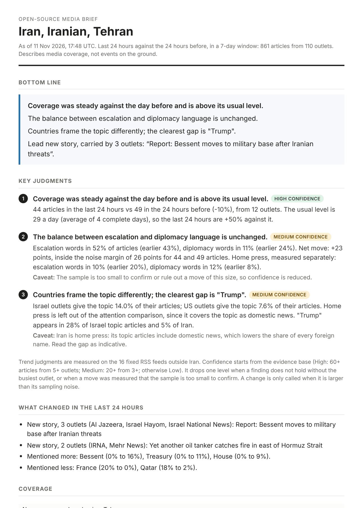
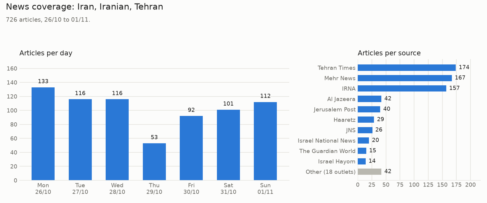
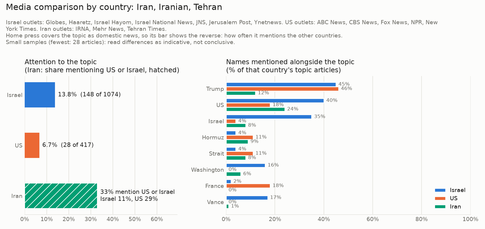
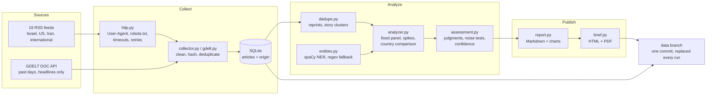

# OSINT News Monitor

[](https://github.com/guyshalom1/osint-news-monitor/actions/workflows/tests.yml)
[](https://github.com/guyshalom1/osint-news-monitor/actions/workflows/monitor.yml)

[](LICENSE)

A Python tool that tracks how a topic is covered across open news sources and writes a daily analytic brief about it: bottom line first, key judgments with confidence levels, what changed in the last 24 hours, and the caveats about the sources. It collects from 19 public RSS feeds in four country groups, backfills history from GDELT, and runs unattended every 6 hours on GitHub Actions.

Built as a personal project to automate a task I do manually as a delegate intern at Israel's Permanent Mission to the UN: following how an issue develops across sources before a meeting.


## The brief

Every run writes a self-contained HTML brief, a PDF of it, and a Markdown report. Current versions, rebuilt every 6 hours from live data: **[brief (PDF)](https://github.com/guyshalom1/osint-news-monitor/blob/data/reports/latest/brief.pdf)** and **[report (Markdown)](https://github.com/guyshalom1/osint-news-monitor/blob/data/reports/latest/report.md)**.

<p align="center"></p>

The screenshot is the brief of 11 November 2026. The charts below are live.





## How it works



1. **Collect** articles from 19 English-language RSS feeds, each tagged by country, into a SQLite database. Duplicates are skipped, so it can run repeatedly and build a history.
   - Israel: Haaretz, Jerusalem Post, Israel Hayom, Israel National News, JNS, Ynetnews, Globes
   - US: New York Times, NPR, Fox News, CBS News, ABC News
   - Iran (state-affiliated, so they show the official line): IRNA, Mehr News, Tehran Times
   - International: BBC, Al Jazeera, The Guardian, UN News
   - Requests identify the project in the User-Agent, obey robots.txt, time out after 20 seconds and retry transient failures with exponential backoff.
   - Every run records source health in `source_status.json`: feeds that failed, feeds that stopped updating, and feeds that turned over completely between runs (so items were probably missed).
2. **Backfill** past days for a topic from [GDELT](https://www.gdeltproject.org/), which indexes thousands of outlets and can be queried by day. Backfilled articles are marked as such in the database.
3. **Filter** articles by keywords (whole-word, case-insensitive).
4. **Analyze**
   - articles per day on a fixed panel of sources, with spike detection
   - reprint removal: copies of the same headline under other domains (mostly wire copy on regional sites) are dropped before counting, keeping the earliest
   - stories: articles with similar headlines from different outlets are grouped, so the report shows which events the most outlets picked up
   - names and places mentioned alongside the topic, extracted with spaCy NER
   - country comparison: share of attention and names mentioned, Israel vs US vs Iran
5. **Assess**: three judgments on the last 24 hours against the 24 hours before (volume, tone, framing between countries), each with a confidence level and the numbers behind it, then what changed: new stories and names mentioned more or less. Rule-based, with no language model.
6. **Publish** the brief (HTML and PDF), the Markdown report and the charts to the `data` branch.

## Method: how a judgment is made

Three rules, each added after the first version of this tool got something wrong on real data (see [docs/AUDIT.md](docs/AUDIT.md)).

**1. Compare like with like.** Change over time is measured on a fixed panel: the RSS feeds, without the topic country's own press. GDELT answers on some days and is rate-limited on others, so including it made a day look busy because the backfill had worked. Iranian state outlets mention Iran in nearly every story, sports and tourism included, so their count measures how much they publish. They supplied over half of all matching articles and were setting the trend.

**2. A change must beat its sampling noise.** Counts are tested as Poisson counts, shares with a two-proportion z-test, and the tone balance as a difference of means, all at 95%. The framing comparison tests several names across several country pairs at once, so its bar is raised (Bonferroni). A 6-point move in tone on 150 articles used to be reported as a shift. It is noise, and is now reported as "unchanged" with the margin stated.

**3. One outlet is not a trend.** Every finding is recomputed without the busiest outlet. If it does not hold, confidence drops one level and the brief says which outlet carried it.

**Confidence** starts from the evidence base (High: 60+ articles from 5+ outlets; Medium: 20+ from 3+; otherwise Low). It drops one level when a finding fails rule 3, or when a move was measured that the sample is too small to confirm or rule out.

**Tone** uses two short word lists: military action or threat, and negotiation. A term does not count when negated ("rules out a strike") or, for diplomacy, when its failure is reported ("talks collapse"). "War" is not on the list: once a conflict is called "the Iran war", the word appears in one article in five whatever happens.

### Measured accuracy

The two heuristics that read text are scored on 50 articles drawn at random from the live database and labeled by hand (`tests/fixtures/labeled_sample.json`). `make evaluate` reproduces the table, and the tests fail if a change pushes a score below its floor.

| | Precision | Recall | F1 |
|---|---|---|---|
| Names: spaCy `en_core_web_sm` | 0.92 | 0.89 | 0.90 |
| Names: regex fallback | 0.73 | 0.80 | 0.76 |
| Tone: escalation list | 0.79 | 0.60 | 0.68 |
| Tone: diplomacy list | 1.00 | 0.75 | 0.86 |

The regex's weakness is precision: in a title-case headline every word looks like a name ("Refrigeration Systems"), and it cannot read "U.S.". The escalation list misses hostile acts described without its vocabulary (a cyberattack, "give them the hammer"). It is used only to compare one day with the next, where a consistent miss affects both sides equally. One annotator and 50 articles, so the scores are indicative.

## Usage

```bash
make install     # package, dev tools, spaCy model, PDF support
make check       # lint, type check, tests (no network needed)
make run         # collect now, write output/brief.html and output/report.md
make evaluate    # score name extraction and the tone lists on the labeled sample
```

Or step by step:

```bash
pip install -e ".[nlp,pdf]" && python -m spacy download en_core_web_sm

# collect new articles (run a few times a day to build history)
osint-monitor --db data/articles.db collect

# fill the last 7 days for a topic from GDELT (optional)
osint-monitor --db data/articles.db backfill --keywords Iran Iranian Tehran --days 7

# write the brief, the report and the charts
osint-monitor --db data/articles.db report --keywords Iran Iranian Tehran --days 7 --out output --pdf
```

Both extras are optional. Without `nlp` the names come from the regex fallback, and without `pdf` the brief is HTML only (it prints cleanly from a browser). Any topic works: `--keywords Hezbollah Lebanon`.

## Design decisions

- **Rule-based, not a language model.** The assessment is built from counts and short word lists, so the same data always gives the same text and every sentence can be traced to a number. That makes it auditable, which matters more than fluency for an analytic product.
- **Confidence is stated, not implied, and it can go down.** Each judgment carries High, Medium or Low. Sample size sets the ceiling, and the robustness and noise checks lower it. One outlet repeating itself does not raise confidence.
- **Not calling a change is a result.** When a move is inside its noise margin the brief says "unchanged", gives the measured move and the margin, and lowers confidence. On a normal day the panel has about 45 articles in each window, so only tone moves above roughly 25 points can be called.
- **Volume is judged against two baselines.** The last 24 hours are compared with the 24 hours before and with the usual daily level (the average of the complete days before today, at least 3). A 40% drop after an unusually busy day is reported as "fell against the day before and is near its usual level", not as coverage drying up.
- **Shares instead of raw counts.** Feeds differ in size, so countries are compared by the share of their output that covers the topic.
- **Home press is kept apart.** Iranian state outlets cover Iran as domestic news. They are left out of the trend judgments and the attention comparison, their tone is reported on its own line, and a framing gap against them carries a caveat.
- **A country's own name is not a framing gap.** Israeli outlets mention Israel more than US outlets do. That is geography, so it is skipped when looking for the clearest gap.
- **A spike has to clear a real bar.** Each day is tested against the other days at 3 standard deviations, with a floor for counting noise. The earlier rule (1.5 standard deviations over the week) reported a spike in about half of all weeks of pure random variation. This one does so in about 3%, and still catches a doubling 93% of the time at 30 articles a day.
- **NER with a fallback, and both are measured.** spaCy is an optional dependency. Without it the tool still runs on a regex, and the report says which extractor was used.
- **Incomplete days are labeled, not hidden.** Days before collection started are drawn as partial and left out of peak and spike detection.
- **Agency datelines are stripped before names are counted.** Openings like "TEHRAN, Oct. 29 (MNA) -" say who filed the story, not what it is about. Left in, the agency tag "MNA" was the second most common "name" and showed up in the country comparison.
- **Reprints are removed before counting**, so wire copy republished by many sites does not look like independent coverage.
- **Headlines are untrusted input.** They are escaped in Markdown tables and in the HTML brief, and only http(s) links are rendered.
- **Data is state, not source.** The database and reports live on the `data` branch, which holds exactly one commit that each run replaces. A binary file cannot be diffed, so its history is only weight, and `main` stays a history of human changes. The last 14 days of snapshots are kept as workflow artifacts for rollback, the database is integrity-checked before it is published, and articles older than 180 days are pruned so the file stays far below GitHub's 100 MB limit.
- **Failures are visible.** Each run records source health, a failed scheduled run opens a GitHub issue, and CI runs lint, type checks and tests on two Python versions, plus once without the optional dependencies.

## Limitations

- The assessment describes what media report, not what happens on the ground. Coverage volume is not importance: one outlet publishing many short updates can inflate a day's count.
- English only. Hebrew, Persian and Arabic coverage, where much of the domestic debate happens, is not seen.
- Tone uses short word lists. They miss sarcasm, implication and context, and they count hypotheticals ("ready to strike if needed") as escalation language. Recall on the labeled sample is 0.60.
- The noise tests assume independent articles. News comes in bursts around events, so real variation is larger than the tests assume and the margins are a lower bound.
- Outlets are not independent. Two sites rewriting the same wire story count as two outlets, both for stories and for confidence.
- Iranian outlets are state-affiliated. Press TV (no dates), Tasnim and Fars (no connection from cloud servers) and Iran International (empty feed) could not be used.
- Israeli feeds are general news while US feeds are world sections, so attention shares are indicative, not like-for-like. Times of Israel and i24NEWS block automated access from cloud servers.
- Short feeds lose items. A feed that carries 10 items and is polled every 6 hours drops articles on a busy day. Such runs are flagged in source health, not repaired.
- RSS feeds only carry recent items, so trends become meaningful after the collector has run for several days.
- GDELT results carry titles only, and it matches keywords in the full article text, so backfilled articles whose title lacks the keyword are filtered out. It is capped at 250 articles per day per query; a capped day is not marked complete.
- Reprint removal and story grouping compare headline words only (Jaccard similarity), so paraphrased headlines that share few words are treated as different stories. Grouping is deliberately conservative: one event can show up as two or three stories rather than risk merging unrelated ones.
- The small spaCy model was trained on general news and web text. It misses some names in headlines, and the labeled sample is 50 articles from one topic and one week.

## Project structure

```
osint_monitor/
  sources.py     list of RSS feeds, tagged by country
  http.py        polite fetching: User-Agent, robots.txt, timeouts, retries
  collector.py   fetch, clean, deduplicate and store articles; source health; pruning
  gdelt.py       historical backfill from the GDELT DOC API
  dedupe.py      reprint removal and story grouping by headline similarity
  entities.py    names and places: spaCy NER with a regex fallback
  analyzer.py    keyword filter, fixed panel, daily counts, spikes, country comparison
  assessment.py  key judgments, noise tests, confidence, what changed in 24 hours
  report.py      Markdown report and charts
  brief.py       HTML and PDF brief (templates/brief.html)
  evaluate.py    scores the heuristics against hand-labeled articles
  models.py      typed shapes of the data passed between modules
  cli.py         command-line interface (osint-monitor)
tests/           135 tests, no network: faked HTTP, a sample feed, a labeled sample
docs/            audit of the first version, screenshot
.github/         scheduled collection (every 6 hours) and CI
```

The code is fully type-annotated and checked with `mypy --strict`. See [CHANGELOG.md](CHANGELOG.md) for what changed in 1.0 and why.

## Possible next steps

- Hebrew and Arabic sources
- A larger labeled sample with a second annotator, and a held-out set
- Story grouping on sentence embeddings instead of headline words
- Alerts on spikes (failed runs already open a GitHub issue)

## License

[MIT](LICENSE)
