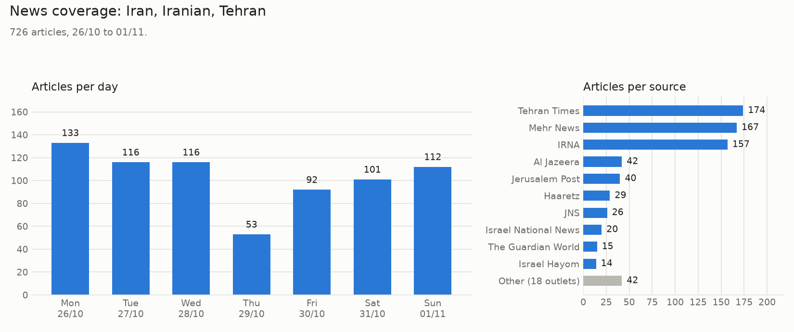
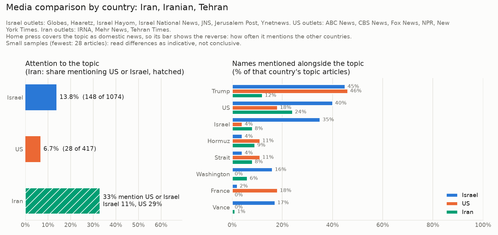

# OSINT Coverage Report: Iran, Iranian, Tehran

Generated 2026-11-04 06:25 UTC. Period: last 7 days. Matching articles: 714 (5 reprints removed).

## Assessment

The last 24 hours compared with the 24 hours before. Rule-based, from coverage counts only. It describes what the media report, not what is happening on the ground.

1. **Coverage is steady.** Confidence: High. 124 articles in the last 24 hours vs 120 in the 24 hours before (+3%), from 16 outlets. The usual level is 108 a day (average of 4 complete days), so the last 24 hours are +15% against it.
2. **Language is shifting toward diplomacy.** Confidence: High. Escalation words in 26% of articles (earlier 35%), diplomacy words in 21% (earlier 25%).
3. **Countries frame the topic differently; the clearest gap is "Trump".** Confidence: Medium. Israel outlets give the topic 12.9% of their articles; US outlets give the topic 6.2% of their articles. Home press is left out of the attention comparison, since it covers the topic as domestic news. "Trump" appears in 39% of Israel topic articles and 4% of Iran.

Confidence: High means 60+ articles from 5+ outlets, Medium means 20+ from 3+ outlets, Low means less than that.

## What changed in the last 24 hours

- New story, 2 outlets: Iran harbors no hostility toward regional states: FM Araghchi
- New story, 2 outlets: Iranian judo athlete Karimi wins silver at 2026 Youth Olympic Games
- New story, 2 outlets: Former Iran captain Hassan Habibi passes away
- Mentioned more: US (24% to 37%), Pezeshkian (2% to 11%), Trump (12% to 19%).
- Mentioned less: Araghchi (13% to 2%), Strait (13% to 7%), China (7% to 2%).

## Key findings

- Peak coverage on 2026-11-03: 131 articles.
- Most widely covered story: "IRGC Navy: Two violating oil tankers stopped in south of Strait of Hormuz", reported by 3 outlets.
- No unusual spikes; coverage was steady.
- Tehran Times carried the most coverage (25% of articles).

## Stories covered by the most outlets

| Story | Outlets | First seen |
|---|---|---|
| IRGC Navy: Two violating oil tankers stopped in south of Strait of Hormuz | 3 | 2026-10-30 |
| Iran FM congratulates Algeria on National Day | 2 | 2026-11-01 |
| Iran embassy in Kuwait rejects allegation linking Iranian national to assassination plot | 2 | 2026-10-28 |
| Pezeshkian vows to implement Leader’s directive to end ‘neither war nor peace’ situation | 2 | 2026-10-28 |
| Iran is pursuing energy diplomacy dynamically, resolutely: Minister | 2 | 2026-10-28 |
| IRGC downs 14th US MQ-1 over Strait of Hormuz | 2 | 2026-10-29 |
| Baqaei condemns territorial claims by UAE and Canada regarding three Iranian islands | 2 | 2026-10-29 |
| Iran foreign minister offers condolences to Spain over deadly train crash | 2 | 2026-10-30 |

Stories are groups of articles with similar headlines. Different outlets reporting the same event count once here.

## Coverage by source

| Source | Articles |
|---|---|
| Tehran Times | 180 |
| Mehr News | 159 |
| IRNA | 156 |
| Jerusalem Post | 43 |
| Al Jazeera | 35 |
| JNS | 32 |
| Haaretz | 32 |
| Israel National News | 19 |
| Israel Hayom | 13 |
| The Guardian World | 13 |
| New York Times | 9 |
| CBS News | 6 |
| ABC News | 6 |
| BBC Middle East | 3 |
| NPR | 3 |
| Other (3 outlets) | 5 |

## Names and places mentioned alongside the topic

| Name | Articles |
|---|---|
| US | 192 |
| Trump | 100 |
| Israel | 81 |
| Hormuz | 70 |
| Strait | 67 |
| Araghchi | 62 |
| IRGC | 42 |
| Pezeshkian | 40 |
| Navy | 35 |
| Washington | 34 |

## Media comparison by country

| | Israel | US | Iran |
|---|---|---|---|
| Articles about the topic | 142 of 1102 (12.9%) | 26 of 419 (6.2%) | 499 of 523 (95.4%) home press |
| Home press: articles mentioning US | - | - | 23% |
| Home press: articles mentioning Israel | - | - | 7% |
| Mentions Trump | 39% | 27% | 4% |
| Mentions US | 38% | 8% | 21% |
| Mentions Israel | 34% | 15% | 6% |
| Mentions Strait | 6% | 12% | 10% |
| Mentions Hormuz | 6% | 12% | 9% |
| Mentions Netanyahu | 18% | 0% | 0% |
| Mentions Gulf | 4% | 12% | 0% |
| Mentions Qatar | 2% | 12% | 0% |

**Latest Israel headlines**

- JNS: [GOP holds Florida governor’s mansion, Senate seat as Democrats win in re-drawn seats](https://www.jns.org/news/u-s-news/gop-holds-florida-governors-mansion-senate-seat-as-democrats-win-in-re-drawn-seats)
- Haaretz: [Trump says U.S. has no immediate plans to strike Iran](https://www.haaretz.com/us-news/2026-11-04/ty-article/trump-says-u-s-has-no-immediate-plans-to-strike-iran/000001a1-a40b-d2e9-a5ad-bedb9f210000)
- Jerusalem Post: [Trump says US has no immediate plans to strike Iran, ‘getting everything we want’ in negotiations](https://www.jpost.com/middle-east/iran-news/article-913766)
- Jerusalem Post: [Israel warns US that Iran may use chemical weapons, but Washington questions intelligence - report](https://www.jpost.com/middle-east/iran-news/article-913753)
- Jerusalem Post: [US-Iran talks stuck, sources tell 'Post,' as US sends additional forces to the region](https://www.jpost.com/middle-east/article-913751)

**Latest US headlines**

- New York Times: [More Iranians Call for Nuclear Weapons After War With U.S.](https://www.nytimes.com/2026/11/03/world/europe/iran-nuclear-weapons-war.html)
- New York Times: [Israeli Claims of Iranian Chemical Weapons Divide U.S. Officials](https://www.nytimes.com/2026/11/03/world/middleeast/iran-chemical-weapons-israel-trump.html)
- CBS News: [U.S. launches strikes on Iranian targets in Strait of Hormuz, officials say](https://www.cbsnews.com/video/us-launches-strikes-on-iranian-targets-in-strait-of-hormuz-officials-say/)
- NPR: [Indian navy rescues 20 crew from Iranian fishing boat hijacked off Somalia](https://www.npr.org/2026/11/03/g-s1-151468/indian-navy-rescues-20-crew-from-iranian-fishing-boat-hijacked-off-somalia)
- ABC News: [Indian navy rescues 20 crew from Iranian fishing boat hijacked off Somalia](https://abcnews.com/International/wireStory/indian-navy-rescues-20-crew-iranian-fishing-boat-137803504)

**Latest Iran headlines**

- IRNA: [Four oil tankers trying to break the ban hit mines; IRGC shoots down 56th MQ-9 drone](https://en.irna.ir/news/86311879/Four-oil-tankers-trying-to-break-the-ban-hit-mines-IRGC-shoots)
- IRNA: [Annual reports on rights violations in US, UK unveiled](https://en.irna.ir/photo/86311896/Annual-reports-on-rights-violations-in-US-UK-unveiled)
- Mehr News: [Trump vows to end annual military aid to Israel: Report](https://en.mehrnews.com/news/249153/Trump-vows-to-end-annual-military-aid-to-Israel-Report)
- Mehr News: [Democrats take Senate majority](https://en.mehrnews.com/news/249152/Democrats-take-Senate-majority)
- Mehr News: [IRGC says 4 oil tankers destroyed, 56th US drone downed](https://en.mehrnews.com/news/249151/IRGC-says-4-oil-tankers-destroyed-56th-US-drone-downed)

Caveats: Israeli feeds are general news, US feeds are world sections, so the share of attention is not a like-for-like comparison. Outlets with longer feeds weigh more within their country. Home press (here the Iranian outlets) is state or state-affiliated. It shows the official line, not public opinion, and it covers the topic as domestic news, so its share of attention is not comparable.

## Latest headlines

- 2026-11-04 | IRNA | [Four oil tankers trying to break the ban hit mines; IRGC shoots down 56th MQ-9 drone](https://en.irna.ir/news/86311879/Four-oil-tankers-trying-to-break-the-ban-hit-mines-IRGC-shoots)
- 2026-11-04 | IRNA | [Annual reports on rights violations in US, UK unveiled](https://en.irna.ir/photo/86311896/Annual-reports-on-rights-violations-in-US-UK-unveiled)
- 2026-11-04 | Mehr News | [Trump vows to end annual military aid to Israel: Report](https://en.mehrnews.com/news/249153/Trump-vows-to-end-annual-military-aid-to-Israel-Report)
- 2026-11-04 | Mehr News | [Democrats take Senate majority](https://en.mehrnews.com/news/249152/Democrats-take-Senate-majority)
- 2026-11-04 | Al Jazeera | [Iran says US reply to Hormuz plan ‘unconvincing’; Trump confirms strikes](https://www.aljazeera.com/news/2026/11/4/iran-says-us-reply-to-hormuz-plan-unconvincing-trump-confirms-strikes?traffic_source=rss)
- 2026-11-04 | Mehr News | [IRGC says 4 oil tankers destroyed, 56th US drone downed](https://en.mehrnews.com/news/249151/IRGC-says-4-oil-tankers-destroyed-56th-US-drone-downed)
- 2026-11-04 | Mehr News | [Iran does not seek nuclear weapons: Diplomat](https://en.mehrnews.com/news/249150/Iran-does-not-seek-nuclear-weapons-Diplomat)
- 2026-11-04 | JNS | [GOP holds Florida governor’s mansion, Senate seat as Democrats win in re-drawn seats](https://www.jns.org/news/u-s-news/gop-holds-florida-governors-mansion-senate-seat-as-democrats-win-in-re-drawn-seats)
- 2026-11-04 | Haaretz | [Trump says U.S. has no immediate plans to strike Iran](https://www.haaretz.com/us-news/2026-11-04/ty-article/trump-says-u-s-has-no-immediate-plans-to-strike-iran/000001a1-a40b-d2e9-a5ad-bedb9f210000)
- 2026-11-04 | Jerusalem Post | [Trump says US has no immediate plans to strike Iran, ‘getting everything we want’ in negotiations](https://www.jpost.com/middle-east/iran-news/article-913766)
