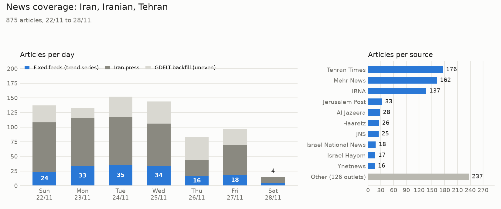
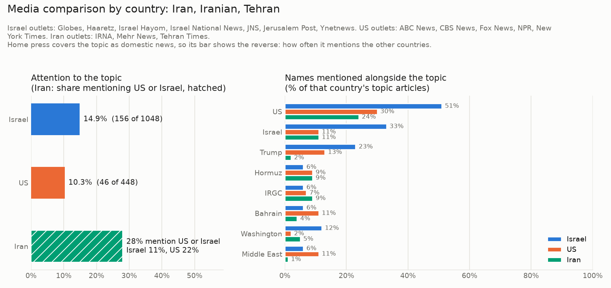

# OSINT Coverage Report: Iran, Iranian, Tehran

Generated 2026-11-21 07:11 UTC. Period: last 7 days. Matching articles: 810 (56 reprints removed).

## Assessment

The last 24 hours compared with the 24 hours before, measured on the 16 fixed RSS feeds outside Iran. Rule-based, from coverage counts only. It describes what the media report, not what is happening on the ground.

1. **Coverage was steady against the day before and is below its usual level.** Confidence: Low. 23 articles in the last 24 hours vs 31 in the 24 hours before (-26%), from 13 outlets. The usual level is 39 a day (average of 4 complete days), so the last 24 hours are -41% against it. With counts this small the sample cannot confirm or rule out a move of this size, so confidence is reduced.
2. **The balance between escalation and diplomacy language is unchanged.** Confidence: Low. Escalation words in 48% of articles (earlier 42%), diplomacy words in 13% (earlier 16%). Net move: +9 points, inside the noise margin of 33 points for 23 and 31 articles. Home press, measured separately: escalation words in 32% (earlier 35%), diplomacy words in 0% (earlier 3%). The sample is too small to confirm or rule out a move of this size, so confidence is reduced.
3. **Countries frame the topic differently; the clearest gap is "US".** Confidence: Medium. Israel outlets give the topic 14.9% of their articles; US outlets give the topic 10.3% of their articles. Home press is left out of the attention comparison, since it covers the topic as domestic news. "US" appears in 51% of Israel topic articles and 24% of Iran. Iran is home press: its topic articles include domestic news, which lowers the share of every foreign name. Read the gap as indicative.

Confidence starts from the evidence base (High: 60+ articles from 5+ outlets; Medium: 20+ from 3+; otherwise Low). It drops one level when a finding does not hold without the busiest outlet, or when a move was measured that the sample is too small to confirm. A change is only called when it is larger than its sampling noise.

## What changed in the last 24 hours

- New story, 2 outlets: Iran shoots down 58th US-made MQ-9 drone over Hormuz: IRGC
- Mentioned more: Israel (10% to 52%), North American (0% to 17%), Shabbat (0% to 17%).
- Mentioned less: Ukraine (16% to 0%).

## Key findings

- Peak coverage on 2026-11-18: 48 articles from the fixed feeds.
- Most widely covered story: "Two tankers strike mines in Strait of Hormuz", reported by 4 outlets.
- No unusual spikes; coverage was steady.
- IRNA carried the most coverage (22% of articles).

## Stories covered by the most outlets

| Story | Outlets | First seen |
|---|---|---|
| Two tankers strike mines in Strait of Hormuz | 4 | 2026-11-14 |
| Grand Ayatollah Vahid Khorasani passes away | 3 | 2026-11-17 |
| Leader offers condolences on Ayatollah Vahid Khorasani demise | 2 | 2026-11-18 |
| Yet another violating oil tanker catches fire in east Hormuz | 2 | 2026-11-14 |
| Iranian Army shoots down MQ-1 drone over Strait of Hormuz | 2 | 2026-11-16 |
| North Macedonia, Greece foil alleged Iranian assassination plot targeting Israeli executive | 2 | 2026-11-17 |
| Third tanker hits naval mine in eastern Strait of Hormuz | 2 | 2026-11-17 |
| Violating oil tanker hit by mine east of Strait of Hormuz | 2 | 2026-11-14 |

Stories are groups of articles with similar headlines. Different outlets reporting the same event count once here.

## Coverage by source

| Source | Articles |
|---|---|
| IRNA | 176 |
| Mehr News | 172 |
| Tehran Times | 162 |
| Jerusalem Post | 45 |
| JNS | 32 |
| Haaretz | 25 |
| Israel National News | 22 |
| Ynetnews | 22 |
| Al Jazeera | 19 |
| Israel Hayom | 14 |
| Fox News | 13 |
| New York Times | 12 |
| The Guardian World | 11 |
| CBS News | 8 |
| ABC News | 6 |
| Other (53 outlets) | 71 |

## Names and places mentioned alongside the topic

| Name | Articles |
|---|---|
| US | 253 |
| Israel | 119 |
| Hormuz | 69 |
| Trump | 69 |
| IRGC | 64 |
| Bahrain | 48 |
| Washington | 47 |
| Araghchi | 42 |
| Russia | 34 |
| China | 32 |

Names extracted with spaCy named-entity recognition.

## Media comparison by country

| | Israel | US | Iran |
|---|---|---|---|
| Articles about the topic | 156 of 1048 (14.9%) | 46 of 448 (10.3%) | 518 of 553 (93.7%) home press |
| Home press: articles mentioning US | - | - | 22% |
| Home press: articles mentioning Israel | - | - | 11% |
| Mentions US | 51% | 30% | 24% |
| Mentions Israel | 33% | 11% | 11% |
| Mentions Trump | 23% | 13% | 2% |
| Mentions Hormuz | 6% | 9% | 9% |
| Mentions IRGC | 6% | 7% | 9% |
| Mentions Bahrain | 6% | 11% | 4% |
| Mentions Washington | 12% | 2% | 5% |
| Mentions Middle East | 6% | 11% | 1% |

**Latest Israel headlines**

- JNS: [Will political considerations lead to inaction against Iran?](https://www.jns.org/opinion/column/jonathan-s-tobin/will-political-considerations-lead-to-inaction-against-iran)
- Israel National News: [Vance on Iran war and midterms loss: My job is to support Trump](https://www.israelnationalnews.com/flashes/698087)
- Jerusalem Post: [Trump addresses Iran, AI, tariffs in White House press briefing following China trip](https://www.jpost.com/international/article-915604)
- Israel National News: [Trump warns Iran: US will not allow development of a 'dirty bomb'](https://www.israelnationalnews.com/flashes/698084)
- Israel National News: [Iran strike imminent? IDF Spokesperson urges public to ignore rumors](https://www.israelnationalnews.com/flashes/698083)

**Latest US headlines**

- ABC News: [Athlete swims in Strait of Hormuz to highlight Iran war's impact on wildlife](https://abcnews.com/International/wireStory/endurance-athlete-swims-strait-hormuz-highlight-iran-wars-138338972)
- CBS News: [Trump insists he's "not rushing to make any decisions on Iran"](https://www.cbsnews.com/live-updates/iran-war-trump-tehran-denies-chemical-weapons/)
- New York Times: [Iraqi Forces Enter Stronghold of Powerful Iran-Backed Militia](https://www.nytimes.com/2026/11/20/world/middleeast/iraq-militia-iran-kataib-hezbollah.html)
- ABC News: [Saudi Arabia intercepts more Yemen Houthi missiles and drones, and other Mideast news](https://abcnews.com/International/wireStory/saudi-arabia-intercepts-yemen-houthi-missiles-drones-mideast-138314659)
- NPR: [Dems aim to block Iran war funding. And, Army delays lead azide detonation in Iowa](https://www.npr.org/2026/11/20/g-s1-154582/up-first-newsletter-democrats-iran-war-trump-xi-jinping-iowa-army)

**Latest Iran headlines**

- IRNA: [Iran’s Kanoon urges UNICEF to pursue justice for war-hit children](https://en.irna.ir/news/86327936/Iran-s-Kanoon-urges-UNICEF-to-pursue-justice-for-war-hit-children)
- Mehr News: ["Let us not forget Palestine and people of Gaza"](https://en.mehrnews.com/news/249563/Let-us-not-forget-Palestine-and-people-of-Gaza)
- Mehr News: [Non-compliant tanker blasts after hitting mine near Oman port](https://en.mehrnews.com/news/249562/Non-compliant-tanker-blasts-after-hitting-mine-near-Oman-port)
- IRNA: [In photos: Iran commemorates martyred Leader](https://en.irna.ir/photo/86327830/In-photos-Iran-commemorates-martyred-Leader)
- IRNA: [IRGC shoots down 58th US MQ-9 drone over Strait of Hormuz](https://en.irna.ir/news/86327810/IRGC-shoots-down-58th-US-MQ-9-drone-over-Strait-of-Hormuz)

Caveats: Israeli feeds are general news, US feeds are world sections, so the share of attention is not a like-for-like comparison. Outlets with longer feeds weigh more within their country. Home press (here the Iranian outlets) is state or state-affiliated. It shows the official line, not public opinion, and it covers the topic as domestic news, so its share of attention is not comparable.

## Latest headlines

- 2026-11-21, ABC News: [Athlete swims in Strait of Hormuz to highlight Iran war's impact on wildlife](https://abcnews.com/International/wireStory/endurance-athlete-swims-strait-hormuz-highlight-iran-wars-138338972)
- 2026-11-21, IRNA: [Iran’s Kanoon urges UNICEF to pursue justice for war-hit children](https://en.irna.ir/news/86327936/Iran-s-Kanoon-urges-UNICEF-to-pursue-justice-for-war-hit-children)
- 2026-11-21, Mehr News: ["Let us not forget Palestine and people of Gaza"](https://en.mehrnews.com/news/249563/Let-us-not-forget-Palestine-and-people-of-Gaza)
- 2026-11-21, Mehr News: [Non-compliant tanker blasts after hitting mine near Oman port](https://en.mehrnews.com/news/249562/Non-compliant-tanker-blasts-after-hitting-mine-near-Oman-port)
- 2026-11-21, IRNA: [In photos: Iran commemorates martyred Leader](https://en.irna.ir/photo/86327830/In-photos-Iran-commemorates-martyred-Leader)
- 2026-11-21, IRNA: [IRGC shoots down 58th US MQ-9 drone over Strait of Hormuz](https://en.irna.ir/news/86327810/IRGC-shoots-down-58th-US-MQ-9-drone-over-Strait-of-Hormuz)
- 2026-11-21, Mehr News: [Iran to never forget Minab School's mishap: mission](https://en.mehrnews.com/news/249561/Tehran-to-never-forget-Minab-School-mishap-Iran-UN-mission)
- 2026-11-21, IRNA: [Iranians will never forget Minab school tragedy: Iran’s UN mission](https://en.irna.ir/news/86327823/Iranians-will-never-forget-Minab-school-tragedy-Iran-s-UN-mission)
- 2026-11-21, IRNA: [President Pezeshkian congratulates Jafari, Beiranvand on AFC honors](https://en.irna.ir/news/86327817/President-Pezeshkian-congratulates-Jafari-Beiranvand-on-AFC)
- 2026-11-21, Mehr News: [Iran uranium reserves used in compatible with needs: Araghchi](https://en.mehrnews.com/news/249560/Any-deal-must-be-honorable-lasting-prevent-a-return-to-war)
