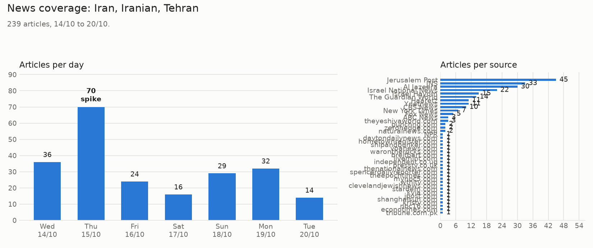
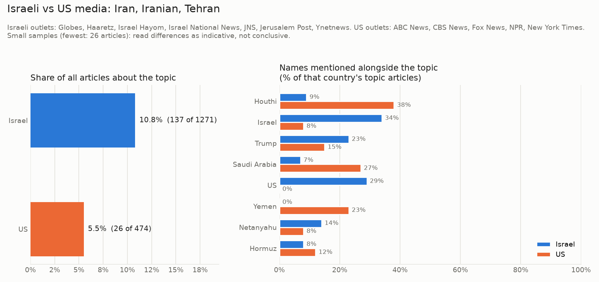

# OSINT Coverage Report: Iran, Iranian, Tehran

Generated 2026-10-20 11:38 UTC. Period: last 7 days. Matching articles: 239 (28 reprints removed).

## Key findings

- Peak coverage on 2026-10-15: 70 articles.
- Most widely covered story: "Spy chief says Iran targeting military sites, suspected plot at RAF base 'not unique’", reported by 2 outlets.
- Spike on 2026-10-15, reported by: Al Jazeera, CBS News, Fox News, Haaretz, Israel Hayom, Israel National News, JNS, Jerusalem Post, New York Times, The Guardian World, Ynetnews, breitbart.com, clevelandjewishnews.com, econotimes.com, hometownregister.com, independent.co.ug, jpost.com, kristv.com, kvia.com, livemint.com, mynbc5.com, naturalnews.com, nbc16.com, presstv.co.uk, punchng.com, shanghaisun.com, shipandbunker.com, spencerdailyreporter.com, stardem.com, theepochtimes.com, thenationalnews.com, theyeshivaworld.com, tribune.com.pk, voanews.com, warontherocks.com, wthitv.com, zerohedge.com.
- Jerusalem Post carried the most coverage (19% of articles).

## Stories covered by the most outlets

| Story | Outlets | First seen |
|---|---|---|
| Spy chief says Iran targeting military sites, suspected plot at RAF base 'not unique’ | 2 | 2026-10-13 |
| Report: U.S. weighing use of 'mother of all bombs' against Iran | 2 | 2026-10-15 |
| Ousted general warned of missile defense shortage before Iran war | 2 | 2026-10-15 |
| CNN sources : US considering using mother of all bomb against Iran | 2 | 2026-10-15 |
| US sanctions Cuban bank accused of ties to Iran bank | 2 | 2026-10-15 |
| Germany summons Iranian envoy over plot to kill leaders of local Jewish organizations | 2 | 2026-10-19 |

Stories are groups of articles with similar headlines. Different outlets reporting the same event count once here.

## Coverage by source

| Source | Articles |
|---|---|
| Jerusalem Post | 45 |
| JNS | 33 |
| Al Jazeera | 30 |
| Israel National News | 22 |
| Israel Hayom | 15 |
| The Guardian World | 14 |
| Haaretz | 11 |
| Ynetnews | 11 |
| CBS News | 10 |
| New York Times | 7 |
| Fox News | 5 |
| ABC News | 3 |
| theyeshivaworld.com | 3 |
| punchng.com | 2 |
| zerohedge.com | 2 |
| naturalnews.com | 2 |
| NPR | 1 |
| daytondailynews.com | 1 |
| hometownregister.com | 1 |
| shipandbunker.com | 1 |
| voanews.com | 1 |
| warontherocks.com | 1 |
| breitbart.com | 1 |
| livemint.com | 1 |
| independent.co.ug | 1 |
| presstv.co.uk | 1 |
| thenationalnews.com | 1 |
| spencerdailyreporter.com | 1 |
| theepochtimes.com | 1 |
| mynbc5.com | 1 |
| wthitv.com | 1 |
| clevelandjewishnews.com | 1 |
| stardem.com | 1 |
| kvia.com | 1 |
| jpost.com | 1 |
| shanghaisun.com | 1 |
| kristv.com | 1 |
| nbc16.com | 1 |
| econotimes.com | 1 |
| tribune.com.pk | 1 |

## Names and places mentioned alongside the topic

| Name | Articles |
|---|---|
| US | 62 |
| Israel | 54 |
| Trump | 44 |
| Houthi | 32 |
| Netanyahu | 25 |
| Hormuz | 24 |
| Israeli | 20 |
| Saudi Arabia | 20 |
| Strait | 17 |
| Yemen | 15 |

## Israeli vs US media

| | Israel | US |
|---|---|---|
| Articles about the topic | 137 of 1271 (10.8%) | 26 of 474 (5.5%) |
| Mentions Houthi | 9% | 38% |
| Mentions Israel | 34% | 8% |
| Mentions Trump | 23% | 15% |
| Mentions Saudi Arabia | 7% | 27% |
| Mentions US | 29% | 0% |
| Mentions Yemen | 0% | 23% |
| Mentions Netanyahu | 14% | 8% |
| Mentions Hormuz | 8% | 12% |

**Latest Israel headlines**

- Jerusalem Post: [Pakistani army chief, key mediator in US-Iran war, arrives in Tehran to meet senior officials](https://www.jpost.com/middle-east/iran-news/article-912278)
- JNS: [Iran, Hamas and Hezbollah rebuilding capabilities as elections approach](https://www.jns.org/jns-tv/the-quad/iran-hamas-and-hezbollah-rebuilding-capabilities-as-elections-approach)
- JNS: [Iran’s Islamic regime faces growing armed opposition from within](https://www.jns.org/jns-tv/meira-k-show/irans-islamic-regime-faces-growing-armed-opposition-from-within)
- JNS: [IDF: Lebanese Army failed to dismantle Hezbollah weapons site](https://www.jns.org/news/israel-news/idf-lebanese-army-failed-to-dismantle-hezbollah-weapons-site)
- Israel Hayom: [Will Iran's nuclear facilities be attacked before the elections?](https://www.israelhayom.com/2026/10/20/will-irans-nuclear-facilities-be-attacked-before-the-elections/)

**Latest US headlines**

- New York Times: [Hegseth Said to Make Unannounced Visit to Israel for Talks With Netanyahu](https://www.nytimes.com/2026/10/20/world/middleeast/hegseth-netanyahu-trump-israel-election.html)
- CBS News: [Hegseth meets Netanyahu ahead of elections, possible Iran war restart](https://www.cbsnews.com/news/hegseth-visits-israel-elections-iran-war-netanyahu/)
- Fox News: [Beleaguered Macron cites US-Iran war as factor in protests amid Trump, Vance criticism](https://www.foxnews.com/world/beleaguered-macron-cites-us-iran-war-factor-protests-amid-trump-vance-criticism)
- New York Times: [Houthi Strikes Kill Dozens in Yemeni Desert Military Camp, Officials Say](https://www.nytimes.com/2026/10/19/world/middleeast/houthis-strike-yemen-military-camp.html)
- CBS News: [Russian envoy says visit to Iran aimed at averting return to war](https://www.cbsnews.com/live-updates/iran-war-us-trump-talks-russia-strait-of-hormuz/)

Caveats: Israeli feeds are general news, US feeds are world sections, so the share of attention is not a like-for-like comparison. Outlets with longer feeds weigh more within their country.

## Latest headlines

- 2026-10-20 | Jerusalem Post | [Pakistani army chief, key mediator in US-Iran war, arrives in Tehran to meet senior officials](https://www.jpost.com/middle-east/iran-news/article-912278)
- 2026-10-20 | New York Times | [Hegseth Said to Make Unannounced Visit to Israel for Talks With Netanyahu](https://www.nytimes.com/2026/10/20/world/middleeast/hegseth-netanyahu-trump-israel-election.html)
- 2026-10-20 | Al Jazeera | [Masoud Pezeshkian: Peace, Not Surrender](https://www.aljazeera.com/video/al-jazeera-world/2026/10/20/masoud-pezeshkian-peace-not-surrender?traffic_source=rss)
- 2026-10-20 | JNS | [Iran, Hamas and Hezbollah rebuilding capabilities as elections approach](https://www.jns.org/jns-tv/the-quad/iran-hamas-and-hezbollah-rebuilding-capabilities-as-elections-approach)
- 2026-10-20 | JNS | [Iran’s Islamic regime faces growing armed opposition from within](https://www.jns.org/jns-tv/meira-k-show/irans-islamic-regime-faces-growing-armed-opposition-from-within)
- 2026-10-20 | JNS | [IDF: Lebanese Army failed to dismantle Hezbollah weapons site](https://www.jns.org/news/israel-news/idf-lebanese-army-failed-to-dismantle-hezbollah-weapons-site)
- 2026-10-20 | Israel Hayom | [Will Iran's nuclear facilities be attacked before the elections?](https://www.israelhayom.com/2026/10/20/will-irans-nuclear-facilities-be-attacked-before-the-elections/)
- 2026-10-20 | JNS | [War is coming ...](https://www.jns.org/opinion/sarah-n-stern/war-is-coming)
- 2026-10-20 | Jerusalem Post | [Trump accuses Iran of killing 75,000, says asking NATO for help during war was test](https://www.jpost.com/middle-east/iran-news/article-912228)
- 2026-10-20 | CBS News | [Hegseth meets Netanyahu ahead of elections, possible Iran war restart](https://www.cbsnews.com/news/hegseth-visits-israel-elections-iran-war-netanyahu/)
